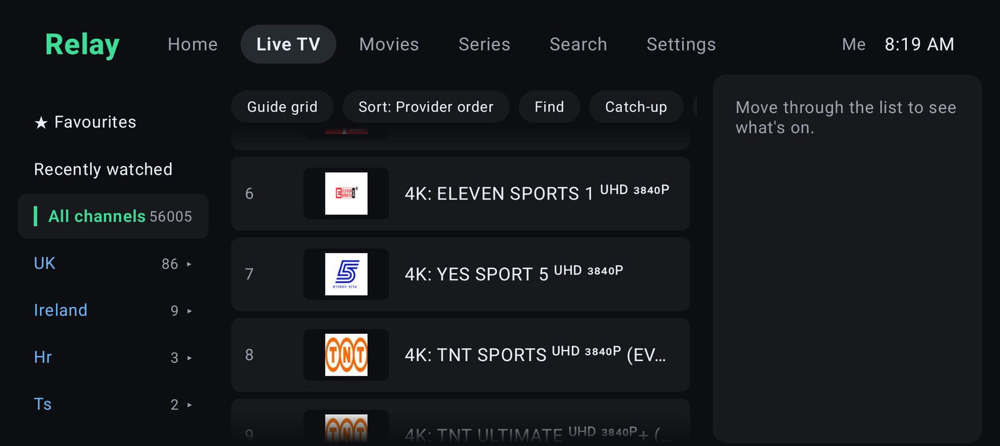
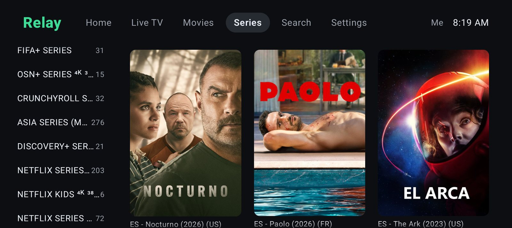

<p align="center">
  
</p>

<p align="center">
  A personal IPTV player for Android TV, Google TV and Android phones.<br>
  Live TV with a guide and catch-up, movies, series, and profiles for the whole family.
</p>

<p align="center">
  <a href="https://github.com/ghoshs89/TV-Relay/releases/latest"><b>Download the latest APK</b></a>
  &nbsp;·&nbsp; <a href="#install">Install</a>
  &nbsp;·&nbsp; <a href="#remote-controls">Remote</a>
  &nbsp;·&nbsp; <a href="#settings-worth-knowing">Settings</a>
  &nbsp;·&nbsp; <a href="#troubleshooting">Help</a>
</p>

<p align="center">
  <a href="https://github.com/ghoshs89/TV-Relay/actions/workflows/build.yml"></a>
</p>

> [!IMPORTANT]
> Keep this repository **private**. It contains no logins or keys, but its Releases hold installable builds, and Relay's updater is set up for a private repo.
>
> The updater uses a fine-grained token with **Contents: Read-only**, limited to this repository, so it can read releases and nothing else. Updates stop arriving when that token expires; see *Update token* under Maintaining Relay.

Relay signs in to an Xtream Codes account and plays what that account provides. No content comes with the app.

<table>
  <tr>
    <td width="50%"><a href="docs/screenshots/home.jpg"></a><br><sub><b>Home</b> · pick up where you left off</sub></td>
    <td width="50%"><a href="docs/screenshots/live-tv.jpg"></a><br><sub><b>Live TV</b> · categories by country, guide, sort and filters</sub></td>
  </tr>
  <tr>
    <td width="50%"><a href="docs/screenshots/series.jpg"></a><br><sub><b>Series</b> · your provider's categories and posters</sub></td>
    <td width="50%"><a href="docs/screenshots/player.jpg"></a><br><sub><b>Player</b> · live 4K, with pause and rewind</sub></td>
  </tr>
</table>

<sub>Screenshots from an Android phone. What you see in your lists depends on your provider.</sub>

## Features

<table>
  <tr><td><b>Watch</b></td><td>Live TV with pause and rewind, catch-up, movies and series with resume, next episode, picture-in-picture on phones</td></tr>
  <tr><td><b>Your languages</b></td><td>English, Hindi and Bengali first by default, then South Indian and Bangladesh; every other language still there, lower down. Order, Home rows and audio follow each profile</td></tr>
  <tr><td><b>Find</b></td><td>Timeline guide with now and next in every list, search that also finds programmes on TV, categories by country and by language, hide or pin categories, favourites, channel groups and renames</td></tr>
  <tr><td><b>Family</b></td><td>Profiles, kids profiles that can't reach adult titles by any route, daily viewing time and bedtime for kids, a parent PIN for anything that changes access</td></tr>
  <tr><td><b>Reliability</b></td><td>One entry per channel with automatic fallback to its other versions, backup servers, stalled streams reconnect on their own, failures explained in plain words, a library refresh that can't wipe your saved lists</td></tr>
  <tr><td><b>Picture and sound</b></td><td>Refresh-rate matching, Dolby and DTS audio, lip-sync adjustment, subtitle style, stream info on start</td></tr>
  <tr><td><b>Extras</b></td><td>Rotten Tomatoes scores (IMDb when there's none), TMDB artwork, programme reminders, Continue watching on the Google TV home screen, a phone page for editing your library, backup and restore, in-app updates</td></tr>
</table>

## Install

1. Download `Relay-1.0.N.apk` from [Releases](https://github.com/ghoshs89/TV-Relay/releases/latest).
2. Install it once by hand (below). After that, Relay updates itself: it checks when it opens and every 30 minutes, shows **Update ready** in the top bar, and installs after one confirmation.

<details>
<summary><b>On a TV, from a computer (adb)</b></summary>

1. On the TV: Settings → System → About → select **Android TV OS build** seven times to unlock Developer options.
2. Settings → System → Developer options → turn on **USB debugging**.
3. Find the TV's IP address in Settings → Network & Internet.
4. On the computer:
   ```
   adb connect 192.168.x.x:5555
   adb install -r Relay-1.0.N.apk
   adb shell appops set dev.relay.tv REQUEST_INSTALL_PACKAGES allow
   ```
   Accept the prompt on the TV the first time. The last line lets Relay install its own updates.

   If `adb connect` is refused on a newer Google TV, turn on **Wireless debugging** instead. Run `adb pair IP:PAIRING_PORT` with the code it shows, then `adb connect IP:PORT`. The two ports are different; use the ones on the TV's screen.

</details>

<details>
<summary><b>On a TV, without a computer</b></summary>

Install *Send Files to TV* on your phone and the TV, send the APK, and open it on the TV with a file manager. Allow installs from that app when asked. The first time Relay updates itself, Android asks you to allow Relay to install apps as well.

</details>

<details>
<summary><b>On a phone</b></summary>

Open the APK from the Releases page and allow your browser to install apps when Android asks.

</details>

## First run

1. Enter a name for the playlist, the server address, any backup servers (comma separated), your username and password. A phone can fill this in for you: scan the QR code on the sign-in screen.
2. Relay checks the login and downloads your channels, movies and series. A large playlist takes about a minute the first time; after that it opens from its saved copy.
3. Pick or create a profile.
4. Set up your library (once, skippable): put your languages in order and untick Live TV countries you never watch. Both can be changed later in Settings → Library.

If your provider gives separate addresses for VPN and non-VPN use, enter the ones that match how this device connects. You can change them later in Settings → Account.

## Remote controls

**Live TV**

| Button | Action |
|---|---|
| Up / Down, Channel − / + | Previous / next channel in the list you opened |
| OK or Left | Channel list over the video |
| Right or Menu | Player controls: audio and subtitle tracks |
| 0 to 9 | Go to a channel number |
| Play/Pause | Pause live TV; Relay keeps recording behind the scenes |
| Left / Right while paused or behind live | Back 10 s / forward 30 s; going forward past the end returns to live |
| Back | Previous channel; press twice quickly to exit |

**Movies and episodes**

| Button | Action |
|---|---|
| Left / Right | Back 10 s / forward 30 s |
| OK | Show the player controls: audio, subtitles and speed |
| Back | Hide the controls; otherwise press twice quickly to exit. Your position is saved. |

**In the guide grid:** OK on a past show plays it from catch-up, on a current show tunes in, and on a future show sets a reminder. In the Live TV list, **Right** opens the channel panel: favourite, guide, catch-up, rename and groups.

## Settings worth knowing

| Where | What |
|---|---|
| **Profiles** | Kids profiles, profile PINs, and the **parent PIN**. Once set, it's needed to add or remove profiles, leave a kids profile, show adult categories, restore a backup, change servers or sign out. A kids profile used last reopens directly when Relay starts. |
| **Profiles** › Viewing time | For each kids profile: minutes per day, bedtime and wake-up time, and **Allow 30 more minutes now**. Only time spent playing counts. |
| **Playback** | Live stream format, pause & rewind buffer (15, 30 or 60 minutes, up to 1.5 GB, deleted when you leave the channel), refresh-rate matching, lip-sync, start on last channel, Continue watching on the TV home screen, audio language order |
| **Subtitles** | Size, colour and background |
| **Channels & guide** | Channel groups, an external XMLTV guide, guide time offset, reminders, **Show each channel once**, **Search the whole TV guide** |
| **Backup & phone** | Phone companion, backup to a file, restore |
| **Library** | **My languages**, **Home screen** rows, **Manage categories** (hide, show, pin, whole countries), start screen, set up my library again, TMDB key and Rotten Tomatoes scores (both optional, below) |
| **Diagnostics** | Recent activity, saved logs, sharing logs, **Library and language report** (what Relay recognised in your playlist) |

<details>
<summary><b>How languages work</b></summary>

Relay sorts everything into five groups: **English**, **Hindi**, **Bengali** (Indian Bengali only), **South Indian** (Tamil, Telugu, Malayalam and Kannada, including Hindi-dubbed South films) and **Bangladesh**. Everything else is *Other*, and titles Relay can't place are *Unclassified*.

- It reads title tags (`HI - `, `SO-IN - `), category names (`HINDI MOVIES`, `BANGLADESH`), well-known channel names (Star Jalsha, Channel i, Sun TV) and country tags. With a TMDB key, a title's original language is learned the first time you open it.
- Your order decides what comes first in lists, search and the guide. Nothing is filtered out; other languages sit lower down.
- Languages marked **Home row** get a *New in …* row on Home. Live TV has a **By language** section, with Bangladesh directly under Bengali.
- Each profile can have its own order (Settings → Library → My languages); profiles without one use the household order chosen during setup.
- If a lot lands in Unclassified, the Library and language report lists the tags and categories it didn't recognise.

</details>

<details>
<summary><b>How Relay stays up when your provider doesn't</b></summary>

- **Backup servers** are tried automatically, both for browsing and during playback.
- **Several versions of a channel** (HD, FHD, HEVC, backup) show as one entry. Your chosen version plays first, otherwise the best quality. If it fails to start, or keeps stalling, Relay switches to the next version on its own. **Versions** in the channel panel lists them all and lets you pick the main one.
- **Stalled streams:** live TV reconnects after 20 seconds of buffering and movies after 30, resuming at the same position. After three tries a channel shows **Retry** and **Next channel** instead of buffering forever.
- **When something fails**, the player says why in plain words after checking your account: login rejected, subscription expired, all your connections in use, the server refusing the stream, or a format the TV can't decode.
- **Pause & rewind** records MPEG-TS channels only; HLS channels play directly. If a channel doesn't work with the buffer, Relay plays it directly instead.
- **Library refresh** happens once your lists are six hours old, including while Relay stays open. A refresh is checked before it replaces anything: an error page, a cut-off list, or a sudden empty list is rejected and your saved library is kept.

</details>

<details>
<summary><b>Backups and the phone companion</b></summary>

A backup holds profiles, favourites, history, channel groups and renames, sort choices, per-series audio and subtitle choices, reminders and settings. It never contains your login, any PIN, or API keys.

A restore checks the whole file first, so nothing changes if it's damaged or from a newer Relay. It then replaces those items on the device, so back up the device first if you might want its current setup back. PINs already set on the device are kept, and Relay lists any profiles that need a PIN set again. Backups from older versions still restore, without their PINs.

Treat backup files as personal: they include your viewing history, and an external guide address can contain your provider login if the provider builds it that way.

The phone companion (Settings → Backup & phone, or the sign-in screen) is a page a phone on the same Wi-Fi opens by scanning a QR code. It can sign the TV in, download a backup and restore one, and **edit your library** with the phone's keyboard: hide, show or pin categories and whole countries, reorder or remove favourite channels, and rename channels. It exists only while that screen is open, and its address includes a random code.

</details>

<details>
<summary><b>Guide search, start over and the home screen</b></summary>

- **Search** shows an *On TV* row: programmes on now (OK to watch) and later (OK sets a reminder). By default it covers channels whose guide Relay has already loaded. **Search the whole TV guide** downloads your provider's full guide for your languages and favourite channels (up to 1,500) every 12 hours. An external XMLTV guide, if set, is searched instead.
- **Start over** in the channel panel plays the current programme from its beginning on channels with catch-up.
- **Continue watching on the home screen** (Google TV and Android TV): movies and episodes you're partway through appear on the TV's own home screen. Choosing one opens Relay and resumes it on the same profile. Kids profiles and adult categories never appear there.

</details>

## Optional extras

<details>
<summary><b>Rotten Tomatoes scores</b></summary>

Settings → Library → Rotten Tomatoes scores. Add a free MDBList key (mdblist.com: sign in, then Preferences → API Access). Movie and series pages then show the critics and audience scores when Rotten Tomatoes has them; titles without a score show nothing extra.

- Lookups happen only when you open a title, after the page appears, and never delay Play.
- Scores are saved and checked again after a day for this year's releases, a week for older titles, and three days for titles with no score.
- The free key allows 1,000 lookups a day. Relay stops at 900 and shows saved scores until the next day.
- **Scores on posters** (on by default) shows the critics score on posters of titles you've already opened. It never makes extra lookups.
- Titles are matched by their TMDB ID. Without one, Relay searches by title and year and shows a score only when there's exactly one match.

</details>

<details>
<summary><b>TMDB artwork and details</b></summary>

Settings → Library → TMDB API key. A free key from themoviedb.org (Settings → API, the 32-character "API Key") adds better backdrops, ratings, genres and cast to movie and series pages. Without it, Relay uses your provider's own information.

</details>

## Troubleshooting

**Logs:** Settings → Diagnostics. Important lines (library loads with timings, downloads, errors, playback problems, and the screen freezing) are always saved, so they survive a force-close. **Save detailed logs** adds every detail line for 24 hours, then turns itself off; disk use is capped at about 1 MB. Usernames, passwords, tokens and API keys are removed from every line. Shared logs start with the device's memory and processor, the library size and the main settings.

To get the logs off a **TV**, open the phone companion (Settings → Backup & phone), scan the QR code and press **Download logs** on the phone. **Share logs** works directly on phones. With adb: `adb pull /sdcard/Android/data/dev.relay.tv/files/logs/`.

**Refreshing the playlist:** the top bar shows how far along it is, and Settings → Account shows the step (downloading, checking, preparing). The percentage is based on how big each list was last time, so the very first download shows megabytes instead. A refresh keeps going if you move to another screen.

**Updates stopped arriving:** the update token has probably expired. See *Update token* under Maintaining Relay, then install the next build by hand once.

**A channel won't play:** try Settings → Playback → Live stream format (MPEG-TS or HLS). Pause & rewind needs MPEG-TS.

## Maintaining Relay

<details>
<summary><b>Signing key</b></summary>

Android installs an update only if it's signed with the same key as the installed app. The key lives in GitHub Secrets, never in the repo. In **Settings → Secrets and variables → Actions**, add:

| Secret | Value |
|---|---|
| `RELAY_KEYSTORE_B64` | The base64 text of `relay-release.jks` |
| `RELAY_KEYSTORE_PASSWORD` | The keystore password |

Every build checks that the APK is signed with this exact key and fails otherwise.

> [!WARNING]
> Keep a copy of the `.jks` file and its password somewhere safe. Losing them means uninstalling and reinstalling Relay on every device.

</details>

<details>
<summary><b>Update token</b></summary>

Because the repo is private, Relay needs a read-only token to see new releases.

1. GitHub → your avatar → **Settings → Developer settings → Personal access tokens → Fine-grained tokens → Generate new token**.
2. Name `Relay updater`, the longest expiry offered, and Repository access: **Only select repositories → TV-Relay**.
3. Repository permissions → **Contents: Read-only**. Nothing else.
4. Save it as the Actions secret **`RELAY_UPDATE_TOKEN`**.

Each build checks that the token can read this repo's releases before building it into the app. When the token nears expiry, replace the secret and let one build install. If it has already expired, install the next build by hand once.

</details>

<details>
<summary><b>Builds and releases</b></summary>

Every push to `main` that changes the app builds it in GitHub Actions and publishes it as release `v1.0.N`. Changes that touch only documentation or tools (`README.md`, `docs/`, `tools/`) don't make a release. You can also start a build from the Actions tab with **Run workflow**.

Before anything is published, the build runs the unit tests and lint. A failing test, or a lint issue that would crash on a device (such as an Android call newer than the TV supports), stops the build. The release APK is shrunk with R8, then started on an Android emulator; if it crashes on launch, nothing is published. Test and lint reports are attached to each run as `reports-1.0.N`.

To build locally (JDK 17 and the Android SDK):

```
./gradlew :app:testReleaseUnitTest
./gradlew :app:lintRelease
./gradlew :app:assembleRelease
```

Without the release key (the `RELAY_KEYSTORE_PATH` and `RELAY_KEYSTORE_PASSWORD` environment variables, or a local `signing.properties`), a local build is signed with a debug key and can't update an installed copy of Relay.

</details>

<details>
<summary><b>App icon and TV banner</b></summary>

The launcher icon, themed icon, legacy icons and TV banner are all generated from one drawing by `tools/icon/build_icon.py`. Run it from the repo root (instructions at the top of the script), then commit the changed files under `app/src/main/res` and `docs/banner.png`.

</details>

<details>
<summary><b>Project layout</b></summary>

```
app/src/main/java/dev/relay/tv/
  RelayApp.kt       app-wide singletons: HTTP client, store, API, catalog, ratings
  MainActivity.kt   navigation root and splash
  data/             Xtream client with server failover, catalog, local store,
                    backups, restrictions, languages, channel versions,
                    kids limits, TMDB and Rotten Tomatoes
  ui/               Compose screens for TV and phone
  player/           Media3 player, pause-buffer recorder, stream recovery
  companion/        phone companion web page and library editor
  tv/               Google TV home screen (Continue watching)
  update/           in-app updater
app/src/test/       unit tests
tools/icon/         icon and banner generator
docs/               README banner and screenshots
```

</details>

## Credits

Built with Jetpack Compose, Media3 ExoPlayer, the Jellyfin FFmpeg audio decoder for Dolby and DTS (GPL-3.0), OkHttp, Coil and kotlinx.serialization. The wordmark uses Space Grotesk (SIL Open Font License).

This product uses the TMDB API but is not endorsed or certified by TMDB. Rotten Tomatoes scores are provided through MDBList; Rotten Tomatoes is a trademark of its owner.

Relay is for personal use and comes with no licence to redistribute.
