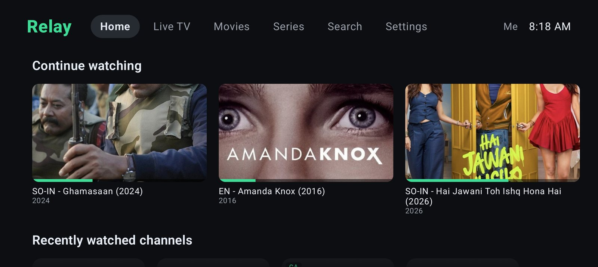
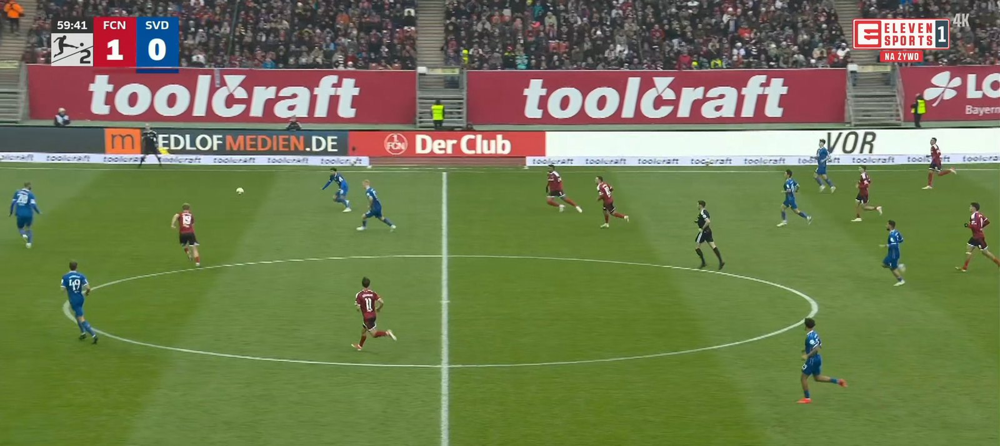

<p align="center">
  
</p>

<p align="center">
  A personal IPTV player for Android TV, Google TV and Android phones.<br>
  Live TV with a guide and catch-up, movies, series, and profiles for the whole family.
</p>

<p align="center">
  <a href="https://github.com/ghoshs89/TV-Relay/releases/latest"><b>Download the latest APK</b></a>
  &nbsp;·&nbsp; <a href="#install">Install</a>
  &nbsp;·&nbsp; <a href="#remote-controls">Remote</a>
  &nbsp;·&nbsp; <a href="#settings-worth-knowing">Settings</a>
  &nbsp;·&nbsp; <a href="#sync-between-screens">Sync</a>
  &nbsp;·&nbsp; <a href="#troubleshooting">Help</a>
</p>

<p align="center">
  <a href="https://github.com/ghoshs89/TV-Relay/actions/workflows/build.yml"></a>
</p>

> [!IMPORTANT]
> Keep this repository **private**. It contains no logins or keys, but its Releases hold installable builds, and Relay's updater is set up for a private repo.
>
> The updater uses a fine-grained token with **Contents: Read-only**, limited to this repository, so it can read releases and nothing else. Updates stop arriving when that token expires; see *Update token* under Maintaining Relay.

Relay signs in to an Xtream Codes account and plays what that account provides. No content comes with the app.

<table>
  <tr>
    <td width="50%"><a href="docs/screenshots/home.jpg"></a><br><sub><b>Home</b> · pick up where you left off</sub></td>
    <td width="50%"><a href="docs/screenshots/live-tv.jpg"></a><br><sub><b>Live TV</b> · categories by country, guide, sort and filters</sub></td>
  </tr>
  <tr>
    <td width="50%"><a href="docs/screenshots/series.jpg"></a><br><sub><b>Series</b> · your provider's categories and posters</sub></td>
    <td width="50%"><a href="docs/screenshots/player.jpg"></a><br><sub><b>Player</b> · live 4K, with pause and rewind</sub></td>
  </tr>
</table>

<sub>Screenshots from an Android phone. What you see in your lists depends on your provider.</sub>

## Features

<table>
  <tr><td><b>Watch</b></td><td>Live TV with pause and rewind, catch-up, movies and series with resume, next episode, picture-in-picture on phones</td></tr>
  <tr><td><b>Your languages</b></td><td>English, Hindi and Bengali first by default, then South Indian and Bangladesh; every other language still there, lower down. Order, Home rows and audio follow each profile</td></tr>
  <tr><td><b>Find</b></td><td>Timeline guide with now and next in every list, search that also finds programmes on TV, categories by country and by language, hide or pin categories, favourites, channel groups and renames</td></tr>
  <tr><td><b>Family</b></td><td>Profiles, kids profiles that can't reach adult titles by any route, daily viewing time and bedtime for kids, a parent PIN for anything that changes access</td></tr>
  <tr><td><b>Reliability</b></td><td>One entry per channel with automatic fallback to its other versions, backup servers, stalled streams reconnect on their own, failures explained in plain words, a library refresh that can't wipe your saved lists</td></tr>
  <tr><td><b>Picture and sound</b></td><td>Refresh-rate matching, Dolby and DTS audio, lip-sync adjustment, subtitle style, stream info on start</td></tr>
  <tr><td><b>Several screens</b></td><td>Optional sync keeps profiles, favourites, watch history, kids' viewing time and shared settings the same on every TV and phone you own, through a private GitHub repository of your own, encrypted before it leaves the screen</td></tr>
  <tr><td><b>Extras</b></td><td>Rotten Tomatoes scores (IMDb when there's none), TMDB artwork, trailers that open in YouTube, API keys sent from your phone, programme reminders, Continue watching on the Google TV home screen, a phone page for editing your library, backup and restore, in-app updates</td></tr>
</table>

## Install

1. Download `Relay-1.0.N.apk` from [Releases](https://github.com/ghoshs89/TV-Relay/releases/latest).
2. Install it once by hand (below). After that, Relay updates itself: it checks when it opens and every 30 minutes, shows **Update ready** in the top bar, and installs after one confirmation.

<details>
<summary><b>On a TV, from a computer (adb)</b></summary>

1. On the TV: Settings → System → About → select **Android TV OS build** seven times to unlock Developer options.
2. Settings → System → Developer options → turn on **USB debugging**.
3. Find the TV's IP address in Settings → Network & Internet.
4. On the computer:
   ```
   adb connect 192.168.x.x:5555
   adb install -r Relay-1.0.N.apk
   adb shell appops set dev.relay.tv REQUEST_INSTALL_PACKAGES allow
   ```
   Accept the prompt on the TV the first time. The last line lets Relay install its own updates.

   If `adb connect` is refused on a newer Google TV, turn on **Wireless debugging** instead. Run `adb pair IP:PAIRING_PORT` with the code it shows, then `adb connect IP:PORT`. The two ports are different; use the ones on the TV's screen.

</details>

<details>
<summary><b>On a TV, without a computer</b></summary>

Install *Send Files to TV* on your phone and the TV, send the APK, and open it on the TV with a file manager. Allow installs from that app when asked. The first time Relay updates itself, Android asks you to allow Relay to install apps as well.

</details>

<details>
<summary><b>On a phone</b></summary>

Open the APK from the Releases page and allow your browser to install apps when Android asks.

</details>

## First run

1. Enter a name for the playlist, the server address, any backup servers (comma separated), your username and password. A phone can fill this in for you: scan the QR code on the sign-in screen.
2. Relay checks the login and downloads your channels, movies and series. A large playlist takes about a minute the first time; after that it opens from its saved copy.
3. Pick or create a profile.
4. Set up your library (once, skippable): put your languages in order and untick Live TV countries you never watch. Both can be changed later in Settings → Library.

If your provider gives separate addresses for VPN and non-VPN use, enter the ones that match how this device connects. You can change them later in Settings → Account.

## Remote controls

**Live TV**

| Button | Action |
|---|---|
| Up / Down, Channel − / + | Previous / next channel in the list you opened |
| OK or Left | Channel list over the video |
| Right or Menu | Player controls: audio and subtitle tracks |
| 0 to 9 | Go to a channel number |
| Play/Pause | Pause live TV; Relay keeps recording behind the scenes |
| Left / Right while paused or behind live | Back 10 s / forward 30 s; going forward past the end returns to live |
| Back | Previous channel; press twice quickly to exit |
| Hold OK (in the channel list) | Add or remove the channel from favourites |

**Movies and episodes**

| Button | Action |
|---|---|
| Left / Right | Back / forward by the sizes set in Settings → Playback (10 s and 30 s to begin with) |
| OK | Show the player controls: audio, subtitles and speed |
| Back | Hide the controls; otherwise press twice quickly to exit. Your position is saved. |

**On a movie or series page:** the **Trailer** button opens the trailer in the YouTube app, and Back returns to the same page. It appears when your provider or TMDB knows a trailer (a TMDB key finds more, including trailers in the film's own language, for example Hindi or Bengali). When none is known, **Find a trailer** opens a YouTube search for the title instead. Neither button appears on kids profiles, because YouTube is outside Relay's kids limits and parent PIN. On a device without YouTube, Relay shows a QR code to watch it on your phone.

**On Home:** hold OK on a Continue watching card or a Recently watched channel to remove it (Menu works too). The **Clear all** button at the end of the Continue watching row empties it after a confirmation.

**In the guide grid:** OK on a past show plays it from catch-up, on a current show tunes in, and on a future show sets a reminder. In the Live TV list, **Right** opens the channel panel: favourite, guide, catch-up, rename and groups.

## Settings worth knowing

| Where | What |
|---|---|
| **Profiles** | Kids profiles, profile PINs, and the **parent PIN**. Once set, it's needed to add or remove profiles, leave a kids profile, show adult categories, restore a backup, change servers or sign out. A kids profile used last reopens directly when Relay starts. |
| **Profiles** › Viewing time | For each kids profile: minutes per day, bedtime and wake-up time, and **Allow 30 more minutes now**. Only time spent playing counts. |
| **Playback** | Live stream format, pause & rewind buffer (15, 30 or 60 minutes, up to 1.5 GB, deleted when you leave the channel), refresh-rate matching, lip-sync, start on last channel, Continue watching on the TV home screen, audio language order, jump sizes for Left and Right, **Sleep timer** (30 to 120 minutes; a warning a minute before the end, and any key press then adds more time) and **Are you still watching?** (pauses after three episodes in a row or four hours of live TV with no key press; closes the player if nobody answers in five minutes) |
| **Subtitles** | Size, colour and background |
| **Channels & guide** | Channel groups, an external XMLTV guide, guide time offset, reminders, **Show each channel once**, **Search the whole TV guide** |
| **Backup & phone** | Phone companion, backup to a file, restore (asks first while sync is on, because a restore spreads to your other screens) |
| **Sync between screens** | Turn on sync, join from another screen, add or remove a screen, sync now, **New household key**, stop syncing on this screen. See [Sync between screens](#sync-between-screens) |
| **Library** | **My languages**, **Home screen** rows, **Manage categories** (hide, show, pin, whole countries), start screen, set up my library again, TMDB key and Rotten Tomatoes scores (both optional, below). The two key rows offer **Send from my phone**, so nothing has to be typed with the remote |
| **Diagnostics** | Recent activity, saved logs, sharing logs, **Library and language report** (what Relay recognised in your playlist) |

<details>
<summary><b>How languages work</b></summary>

Relay sorts everything into five groups: **English**, **Hindi**, **Bengali** (Indian Bengali only), **South Indian** (Tamil, Telugu, Malayalam and Kannada, including Hindi-dubbed South films) and **Bangladesh**. Everything else is *Other*, and titles Relay can't place are *Unclassified*.

- It reads title tags (`HI - `, `SO-IN - `), category names (`HINDI MOVIES`, `BANGLADESH`), well-known channel names (Star Jalsha, Channel i, Sun TV) and country tags. With a TMDB key, a title's original language is learned the first time you open it.
- Your order decides what comes first in lists, search and the guide. Nothing is filtered out; other languages sit lower down.
- Languages marked **Home row** get a *New in …* row on Home. Live TV has a **By language** section, with Bangladesh directly under Bengali.
- Each profile can have its own order (Settings → Library → My languages); profiles without one use the household order chosen during setup.
- If a lot lands in Unclassified, the Library and language report lists the tags and categories it didn't recognise.

</details>

<details>
<summary><b>How Relay stays up when your provider doesn't</b></summary>

- **Backup servers** are tried automatically, both for browsing and during playback.
- **Several versions of a channel** (HD, FHD, HEVC, backup) show as one entry. Your chosen version plays first, otherwise the best quality. If it fails to start, or keeps stalling, Relay switches to the next version on its own. **Versions** in the channel panel lists them all and lets you pick the main one.
- **Stalled streams:** live TV reconnects after 20 seconds of buffering and movies after 30, resuming at the same position. After three tries a channel shows **Retry** and **Next channel** instead of buffering forever.
- **When something fails**, the player says why in plain words after checking your account: login rejected, subscription expired, all your connections in use, the server refusing the stream, or a format the TV can't decode.
- **Pause & rewind** records MPEG-TS channels only; HLS channels play directly. If a channel doesn't work with the buffer, Relay plays it directly instead.
- **Library refresh** happens once your lists are six hours old, including while Relay stays open. A refresh is checked before it replaces anything: an error page, a cut-off list, or a sudden empty list is rejected and your saved library is kept.

</details>

<details>
<summary><b>Backups and the phone companion</b></summary>

A backup holds profiles, favourites, history, channel groups and renames, sort choices, per-series audio and subtitle choices, reminders and settings. It never contains your login, any PIN, or API keys.

A restore checks the whole file first, so nothing changes if it's damaged or from a newer Relay. It then replaces those items on the device, so back up the device first if you might want its current setup back. PINs already set on the device are kept, and Relay lists any profiles that need a PIN set again. Backups from older versions still restore, without their PINs.

**Restoring while sync is on:** Relay asks first, because the restored items count as changes made on this screen and spread to your other screens. To restore on this screen only, stop syncing on it first, restore, and join again afterwards. Before the first sync and before a merged file from your other screens is applied, Relay saves a safety copy of this screen's data (the last three are kept), so a sync that does something unexpected can be undone by restoring that copy.

Treat backup files as personal: they include your viewing history, and an external guide address can contain your provider login if the provider builds it that way.

The phone companion (Settings → Backup & phone, or the sign-in screen) is a page a phone on the same Wi-Fi opens by scanning a QR code. It can sign the TV in, **send API keys** (they are checked before they are saved, and a saved key is never shown on the page), turn on **sync** or replace its token, download a backup and restore one, and **edit your library** with the phone's keyboard: hide, show or pin categories and whole countries, reorder or remove favourite channels, and rename channels. It exists only while that screen is open, and its address includes a random code.

</details>

<details>
<summary><b>Guide search, start over and the home screen</b></summary>

- **Search** shows an *On TV* row: programmes on now (OK to watch) and later (OK sets a reminder). By default it covers channels whose guide Relay has already loaded. **Search the whole TV guide** downloads your provider's full guide for your languages and favourite channels (up to 1,500) every 12 hours. An external XMLTV guide, if set, is searched instead.
- **Start over** in the channel panel plays the current programme from its beginning on channels with catch-up.
- **Continue watching on the home screen** (Google TV and Android TV): movies and episodes you're partway through appear on the TV's own home screen. Choosing one opens Relay and resumes it on the same profile. Kids profiles and adult categories never appear there.

</details>

## Sync between screens

Optional. With sync on, every TV and phone you have shows the same profiles, favourites, Continue watching, kids' viewing time and shared settings. Stop a film on one screen and the next one offers to resume it. Nothing is on until you set it up, and a screen that is offline just carries on by itself and catches up later.

Relay does not run a server for this. The data lives in **one encrypted file in a private GitHub repository of your own**. Each screen reads and writes that file with a token that can reach only that repository. The file is encrypted on the screen before it leaves (AES-256-GCM), with a household key that stays on your screens and never goes to GitHub, so GitHub holds a file it cannot read.

<details>
<summary><b>What you need to make once (about five minutes, on a computer or a phone)</b></summary>

1. On GitHub, make a **private** repository, for example `relay-sync`. Tick **Add a README file** so it isn't empty.
2. GitHub → your avatar → **Settings → Developer settings → Personal access tokens → Fine-grained tokens → Generate new token**.
3. Name it `Relay sync`, pick the longest expiry offered, and under Repository access choose **Only select repositories** and pick the sync repository.
4. Repository permissions → **Contents: Read and write**. Nothing else. This is a different token from the update token: that one only reads this app's releases.
5. Copy the token (it starts with `github_pat_`). GitHub shows it once.

</details>

**Turn it on (first screen):** Settings → Sync between screens → **Turn on sync** (parent PIN if you have one). Scan the QR code with your phone, open the page, find *Sync between screens*, type the repository as `your-name/relay-sync`, paste the token and press **Turn on sync**. Relay checks that the repository is private and that the token can write to it, makes the household key, and does the first sync. The window closes when it is on, and Settings shows the status and the list of screens.

**Add another screen:**

1. On the new screen open Settings → Sync between screens → **Join sync from another screen**. On a fresh install the sign-in page has **I already use Relay on another screen** instead; a screen that joins signs in by itself.
2. On a screen that already syncs open Settings → Sync between screens → **Add a screen** and choose the waiting screen from the list.
3. Both screens now show the same six digits. If they match, press **Yes, they match** on the first screen, then **Join** on the new one. If they differ, press **No** and stop: someone else on your network is getting in the way. The details sent between the screens are sealed with a key worked out from the two screens' own keys, so nothing useful travels in the clear.

The new screen keeps a safety copy of what it had before it joins, then brings its favourites and history together with the others'.

If your Wi-Fi stops the screens from finding each other (some routers block this between devices), and the screen that already syncs is a **phone**: on the phone choose **Add a screen** → **Copy pairing link**, scan the new TV's QR code with the same phone, paste the link into the *Join sync* box on that page and press **Join** on the TV. Anyone who has the link can join your sync, so don't share it. A TV can't pass the pairing link to a phone yet, so this fallback needs the first screen to be a phone.

<details>
<summary><b>What is shared and what stays on each screen</b></summary>

| Shared | Combined how |
|---|---|
| Watch history and positions, per profile | The later entry for each title wins. Removing a card on one screen doesn't come back from another |
| Favourites, per profile | Each add or remove counts separately; the later one wins |
| Profiles: name, colour, kids flag, limits, languages, Home rows, **profile PINs and the parent PIN** | The later change wins, per profile. A deleted profile stays deleted |
| Kids' viewing time today, and "Allow 30 more minutes" | Added up across screens, so 60 minutes a day means 60 minutes in the whole house |
| Your provider login | The later change wins. Changing servers on one screen reloads the library on the others |
| TMDB and MDBList keys, audio and subtitle languages, language order and Home languages, hidden and pinned categories, show each channel once, chosen channel versions, guide address and offset, search the whole guide, scores on posters, hide adult titles, play next episode, jump sizes, "Are you still watching?" and whether setup is done | The later change wins, one setting at a time. Changing the audio language on one screen and the hidden categories on another keeps both |
| Channel groups, renames, chosen channel versions, sort choices, audio and subtitle choice per series, reminders | The later change wins, per item |

| Stays on each screen | Why |
|---|---|
| Lip-sync, refresh-rate matching, stream info, subtitle size, colour and background, theme, keyboard, pause buffer, start screen, sleep timer, live stream format, user agent | They depend on the TV and the room |
| The playlist itself, images, logs, last channel, scroll positions | Each screen downloads and keeps its own |

Two households never mix: the file is tied to the provider account, and a screen signed in to a different account refuses to merge and says so.

</details>

<details>
<summary><b>How and when it runs</b></summary>

- A screen syncs a few seconds after Relay opens, when it comes back to the front, about 30 seconds after you change something, when a film or channel closes, and every 10 minutes while it is open. **Sync now** in Settings does it straight away.
- Relay writes only when something changed, and an idle screen touches the file about once every six hours to show it is still there.
- Two screens changing different things at the same time both win. Two screens changing the same thing: the later change wins, and screens' clocks are compared safely, so a TV whose clock is slow or fast can't win or lose for ever.
- Playback position reaches the other screens when the player closes, not every few seconds.
- **Offline:** nothing breaks. Each screen keeps its own copy, retries after 1, 5 and then 15 minutes, and merges when the network is back. Both screens' changes survive.
- Sync never blocks playback or start-up, and it waits while a slow TV is still reading its library.
- Every change is a commit in your repository, so its history slowly grows (a few kilobytes per change). If you ever want a clean start: stop syncing on every screen, delete the repository, make a new one and a new token, turn sync on from one screen and join the others.

</details>

<details>
<summary><b>Removing a screen, a lost screen, a new token, stopping</b></summary>

- **Remove a screen** (Settings → Sync between screens) only takes it off the list. A screen that still has the key puts itself back the next time it syncs.
- **A lost or sold screen:** on a screen you still have, choose **New household key**. The file is sealed again, and a screen with the old key can no longer open it. Because the old token can still change the file even though it can't read it, also make a new GitHub token (as above) and delete the old one in GitHub. Paste the new token on this screen: Settings → Backup & phone → Phone companion, scan the code, and use *Replace the token* under *Sync between screens*. Then, on each of your other screens, choose **Join again from another screen** (it appears once the status says the key or token no longer works) and add it from this one; the new token travels with the pairing.
- **The token expired or was removed:** the status says *The sync token was refused*. Make a new token as above and paste it under *Replace the token* on the phone page (Settings → Backup & phone → Phone companion). The token is kept on each screen, not in the shared file, so every screen needs it; the quick way is **Join again from another screen** on the others.
- **Stop syncing on this screen** keeps everything on it, forgets the repository, token and key, and takes it off the list. The others keep going. Signing out on a screen that syncs stops sync there too, because the login would otherwise come back from the other screens.
- The token and key are kept in Relay's private storage on each screen, and are removed from every log line. They aren't in backups.

</details>

## Optional extras

<details>
<summary><b>Rotten Tomatoes scores</b></summary>

Settings → Library → Rotten Tomatoes scores. Add a free MDBList key (mdblist.com: sign in, then Preferences → API Access). Choose **Send from my phone**, scan the code and paste the key on the page; a key is checked before it is saved and you see the result on both screens. Or choose **Type it here**. Movie and series pages then show the critics and audience scores when Rotten Tomatoes has them; titles without a score show nothing extra.

- Lookups happen only when you open a title, after the page appears, and never delay Play.
- Scores are saved and checked again after a day for this year's releases, a week for older titles, and three days for titles with no score.
- The free key allows 1,000 lookups a day. Relay stops at 900 and shows saved scores until the next day.
- **Scores on posters** (on by default) shows the critics score on posters of titles you've already opened. It never makes extra lookups.
- Titles are matched by their TMDB ID. Without one, Relay searches by title and year and shows a score only when there's exactly one match.

</details>

<details>
<summary><b>TMDB artwork and details</b></summary>

Settings → Library → TMDB API key, then **Send from my phone** (or **Type it here**). A free key from themoviedb.org (Settings → API) adds better backdrops, ratings, genres, cast and trailers to movie and series pages. Without it, Relay uses your provider's own information. Either the 32-character "API Key" or the longer "API Read Access Token" works, and spaces, quotes or a leading `api_key=` in what you paste are ignored.

</details>

## Troubleshooting

**Logs:** Settings → Diagnostics. Important lines (library loads with timings, downloads, errors, playback problems, and the screen freezing) are always saved, so they survive a force-close. **Save detailed logs** adds every detail line for 24 hours, then turns itself off; disk use is capped at about 1 MB. Usernames, passwords, tokens and API keys are removed from every line. Shared logs start with the device's memory and processor, the library size and the main settings.

To get the logs off a **TV**, open the phone companion (Settings → Backup & phone), scan the QR code and press **Download logs** on the phone. **Share logs** works directly on phones. With adb: `adb pull /sdcard/Android/data/dev.relay.tv/files/logs/`.

**Refreshing the playlist:** the top bar shows how far along it is, and Settings → Account shows the step (downloading, checking, preparing). The percentage is based on how big each list was last time, so the very first download shows megabytes instead. A refresh keeps going if you move to another screen.

**Updates stopped arriving:** the update token has probably expired. See *Update token* under Maintaining Relay, then install the next build by hand once.

**Sync status** (Settings → Sync between screens): *In sync, N minutes ago* is normal. *Waiting for the network* means the last try couldn't reach GitHub; it retries by itself. *The sync token was refused* or *can't be found with this token*: the token expired, was removed, or doesn't cover the repository; make a new one (Contents: read and write) and paste it under *Replace the token* on the phone page. *This screen's sync key doesn't open the file*: the household key was changed; choose **Join again from another screen**. *This screen is signed in to a different provider account*: sync is for one account; sign in with the same one or stop syncing here. *Update Relay on this screen to keep syncing*: another screen has a newer Relay that writes a newer file format; install the update. A message about the repository being public or the token being unable to write appears when sync is turned on; fix the repository or token and try again.

**A channel won't play:** try Settings → Playback → Live stream format (MPEG-TS or HLS). Pause & rewind needs MPEG-TS.

## Maintaining Relay

<details>
<summary><b>Signing key</b></summary>

Android installs an update only if it's signed with the same key as the installed app. The key lives in GitHub Secrets, never in the repo. In **Settings → Secrets and variables → Actions**, add:

| Secret | Value |
|---|---|
| `RELAY_KEYSTORE_B64` | The base64 text of `relay-release.jks` |
| `RELAY_KEYSTORE_PASSWORD` | The keystore password |

Every build checks that the APK is signed with this exact key and fails otherwise.

> [!WARNING]
> Keep a copy of the `.jks` file and its password somewhere safe. Losing them means uninstalling and reinstalling Relay on every device.

</details>

<details>
<summary><b>Update token</b></summary>

Because the repo is private, Relay needs a read-only token to see new releases.

1. GitHub → your avatar → **Settings → Developer settings → Personal access tokens → Fine-grained tokens → Generate new token**.
2. Name `Relay updater`, the longest expiry offered, and Repository access: **Only select repositories → TV-Relay**.
3. Repository permissions → **Contents: Read-only**. Nothing else.
4. Save it as the Actions secret **`RELAY_UPDATE_TOKEN`**.

Each build checks that the token can read this repo's releases before building it into the app. When the token nears expiry, replace the secret and let one build install. If it has already expired, install the next build by hand once.

</details>

<details>
<summary><b>Builds and releases</b></summary>

Every push to `main` that changes the app builds it in GitHub Actions and publishes it as release `v1.0.N`. Changes that touch only documentation or tools (`README.md`, `docs/`, `tools/`) don't make a release. You can also start a build from the Actions tab with **Run workflow**.

Before anything is published, the build runs the unit tests and lint. A failing test, or a lint issue that would crash on a device (such as an Android call newer than the TV supports), stops the build. The release APK is shrunk with R8, then started on an Android emulator; if it crashes on launch, nothing is published. Test and lint reports are attached to each run as `reports-1.0.N`.

Each run also starts a **benchmark** job beside the build: a benchmark variant of the app (`assembleBenchmark`, never published, and the build fails if the release APK contains any of it) is driven on an emulator against a made-up provider (`tools/fake-provider`, 12,000 channels, 40,000 movies, 8,000 series) by `tools/bench/bench.sh`. The job log ends with frame times per screen, list build times and time to first picture. These numbers are for comparing one build with another and spotting a regression. They are not how fast a TV is: the emulator runs on a shared build server with a software renderer, and a TV's processor is slower in different ways. The job never blocks or delays a release. To see the same numbers from a real device, turn on **Save detailed logs** under Diagnostics for a day, use the app as usual, then share the logs: frame timing, list build times and time to first picture are in them.

To build locally (JDK 17 and the Android SDK):

```
./gradlew :app:testReleaseUnitTest
./gradlew :app:lintRelease
./gradlew :app:assembleRelease
```

Without the release key (the `RELAY_KEYSTORE_PATH` and `RELAY_KEYSTORE_PASSWORD` environment variables, or a local `signing.properties`), a local build is signed with a debug key and can't update an installed copy of Relay.

</details>

<details>
<summary><b>App icon and TV banner</b></summary>

The launcher icon, themed icon, legacy icons and TV banner are all generated from one drawing by `tools/icon/build_icon.py`. Run it from the repo root (instructions at the top of the script), then commit the changed files under `app/src/main/res` and `docs/banner.png`.

</details>

<details>
<summary><b>Project layout</b></summary>

```
app/src/main/java/dev/relay/tv/
  RelayApp.kt       app-wide singletons: HTTP client, store, API, catalog, ratings
  MainActivity.kt   navigation root and splash
  data/             Xtream client with server failover, catalog, local store,
                    backups, restrictions, languages, channel versions,
                    kids limits, TMDB and Rotten Tomatoes, trailers,
                    mergeable records and encryption for sync
  ui/               Compose screens for TV and phone
  player/           Media3 player, pause-buffer recorder, stream recovery
  companion/        phone companion web page and library editor
  sync/             sync engine, GitHub storage, pairing and status text
  tv/               Google TV home screen (Continue watching)
  update/           in-app updater
app/src/test/       unit tests
tools/icon/         icon and banner generator
tools/fake-provider/  made-up Xtream provider for the benchmark
tools/bench/        benchmark driver and report
docs/               README banner and screenshots
```

</details>

## Credits

Built with Jetpack Compose, Media3 ExoPlayer, the Jellyfin FFmpeg audio decoder for Dolby and DTS (GPL-3.0), OkHttp, Coil and kotlinx.serialization. The wordmark uses Space Grotesk (SIL Open Font License).

This product uses the TMDB API but is not endorsed or certified by TMDB. Rotten Tomatoes scores are provided through MDBList; Rotten Tomatoes is a trademark of its owner.

Relay is for personal use and comes with no licence to redistribute.
