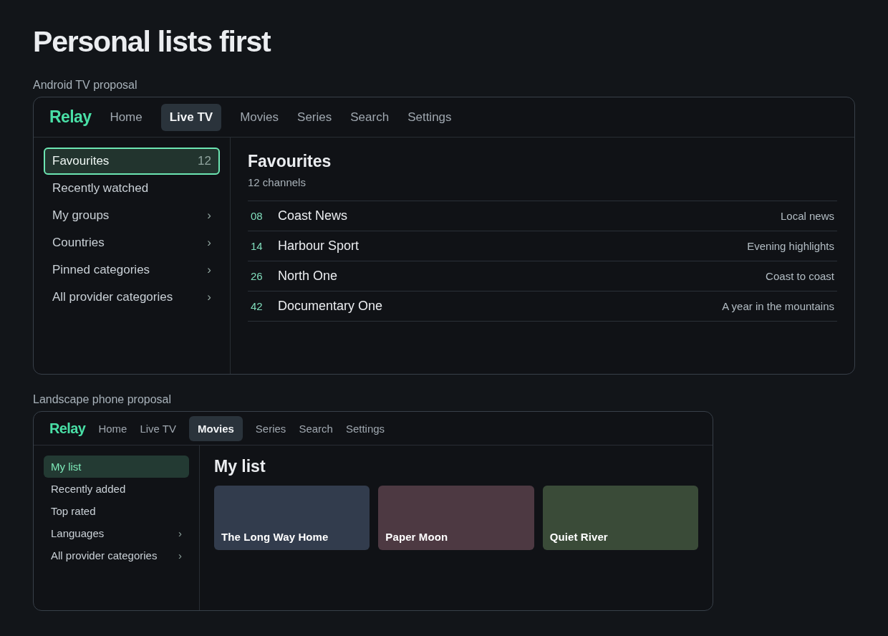
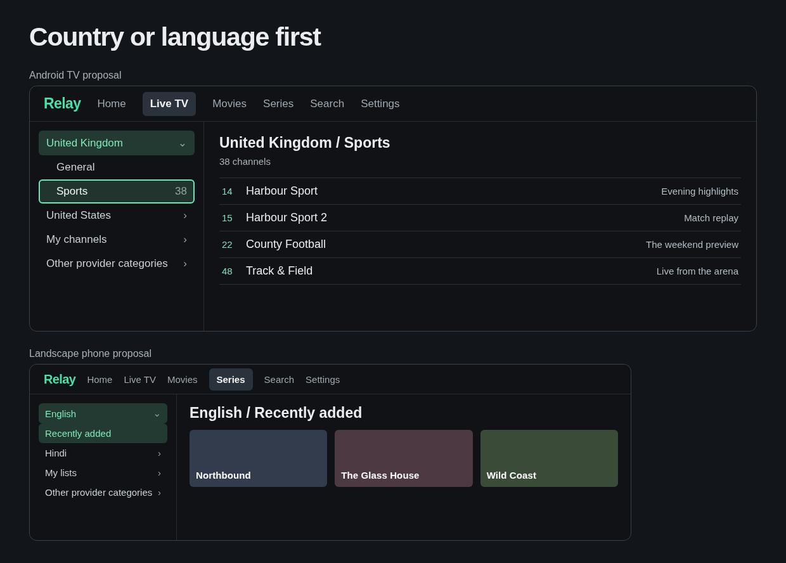

# Browsing large libraries in Relay

Relay already puts Favourites and Recently watched at the top of Live TV. Country groups appear farther down when the provider uses recognisable prefixes consistently. Movies and Series start with four Relay lists, followed by featured languages, pins, and provider categories. The proposals keep those three tabs.

## Personal lists first

Keep Favourites, Recently watched, and user-created groups at the top of Live TV. Give countries and the full provider list their own entry points. In Movies and Series, put My list, Recently added, and Top rated first, followed by language and provider browsing. A pinned category can sit next to the personal lists, with its original location still available through the provider list.

## Country or language first

Lead with preferred countries in Live TV and with preferred languages in Movies and Series. Choosing one opens its category list or catalog, with a Recently added order for titles. Keep a dedicated personal-lists folder at the end of the visible shortcuts. Show **Other provider categories** alongside recognised groups so mixed and unfamiliar labels stay discoverable by their original names.

## Remote walkthrough

This is a count from the sample menus, not a benchmark. The starting focus is the first row of the relevant tab's category rail. Each Down, Right, or OK counts as one press. The first channel in the selected list is the target. For Movies and Series, the task ends with new titles visible in the preferred language.

| Task | Relay today | Personal lists first | Country or language first |
|---|---:|---:|---:|
| Play the first favourite channel | 3 | 3 | 6 |
| Play the first UK sports channel | 12 | 10 | 6 |
| Show recently added English movies or series | 5 | 6 | 2 |

For the Live TV example, today's rail starts with Favourites, Recently watched, All channels, and three language rows, followed by United Kingdom. UK contains General, then Sports. The personal layout starts with Favourites, Recently watched, My groups, then Countries, where United Kingdom comes first. In the country-first layout, United Kingdom comes first and My channels is third. Each channel route ends by moving from the selected category into its channel list and pressing OK. For titles, today's English shortcut is fifth and opens the language view sorted by date added. The personal layout's Languages row is fourth, then English, then Recently added. The language-first layout starts at English and offers Recently added first.

## Recommendation

Use personal lists first for Live TV and a direct language shortcut inside Recently added for Movies and Series. Personal lists and pins stay quick to reach. An explicit country or language entry point lets people who know what they're looking for bypass a large provider list.

Use the existing country and language detection as a starting point. With a catalog on the scale of 50,000 channels and 100,000 titles, keep the rail short, compute counts from existing indexes, and load a single folder's rows at a time. Keep the provider names and IDs for categories without a reliable match. Apply hidden-category and profile restrictions before building folders or counts. On a kids profile, an adult or hidden category must stay absent from shortcuts, counts, and the provider list. When Back closes a folder, return focus to its entry point and retain its scroll position.
